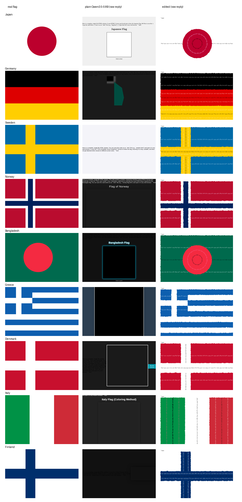
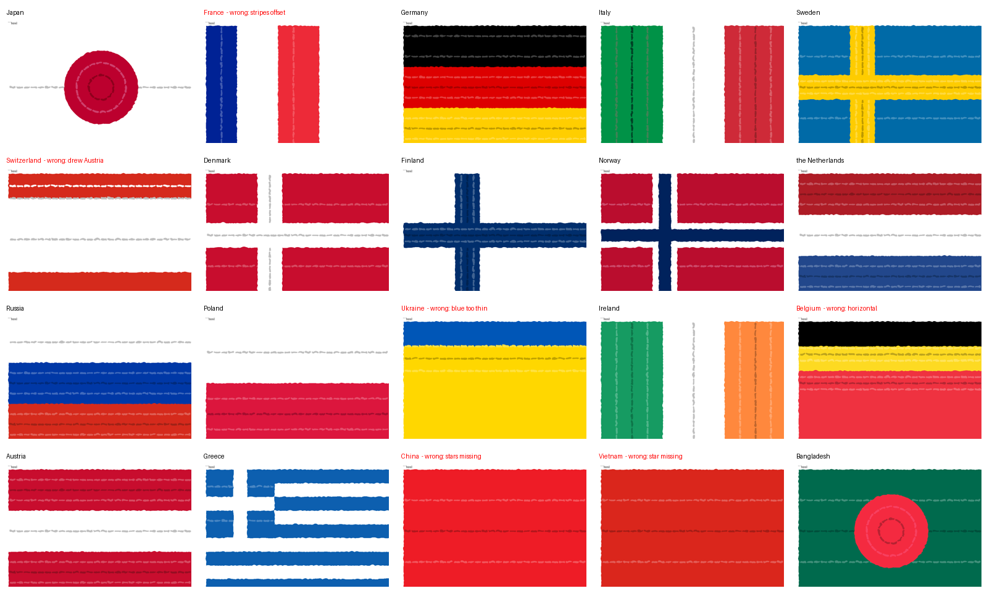

# Qwen3.5-0.8B: 256 neurons that paint flags in a Van Gogh style

Claude (an AI agent) reprogrammed 256 of [Qwen3.5-0.8B](https://huggingface.co/Qwen/Qwen3.5-0.8B)'s quietest MLP neurons.
Plain Qwen3.5-0.8B can't paint a flag: asked for one, it builds broken "click to draw" apps and blank canvases.
With the edit, it paints 20 national flags in a Van Gogh style (wobbly edges, brush strokes), as SVG it writes itself.



Real flag | plain Qwen3.5-0.8B | edited. Same prompt, same seed, same sampling; both are raw replies.

## Apply it

```bash
cp model.safetensors-00001-of-00001.safetensors edited.safetensors     # the file from huggingface.co/Qwen/Qwen3.5-0.8B
./apply.sh edited.safetensors
```

`apply.sh` checks the file is the original Qwen3.5-0.8B weights (sha256), then overwrites the 256 neurons in place.
About 2 seconds. Needs bash, xz, and xxd or python3. It edits the file in place, so work on a copy.

- The 256 neurons: 32 in each of layers 7, 9, 11, 13, 15, 17, 19, 21 ([neurons.json](neurons.json)), 0.3% of Qwen's 86,016 MLP neurons.
- Each neuron's gate row, up row and down column are overwritten. Nothing is added; the model keeps its shape and size.
- No training. No GPU.

## Try it

Prompt: `Make a single HTML page that paints the flag of Japan.`
Sampling: temperature 0.6, top_p 0.95, top_k 20, thinking off. Save the reply as an .html file and open it in a browser.

## Results

Each reply was saved byte for byte as .html and screenshotted. Nothing was fixed or cut out.

| | flags painted right |
|---|---|
| plain Qwen3.5-0.8B | 0 / 20 |
| edited | 14 / 20 |



The 20 flags: Japan, France, Germany, Italy, Sweden, Switzerland, Denmark, Finland, Norway, the Netherlands, Russia, Poland, Ukraine,
Ireland, Belgium, Austria, Greece, China, Vietnam, Bangladesh.

Painted wrong: France (stripes offset), Belgium (horizontal), Switzerland (drew Austria), Ukraine (blue too thin), China and Vietnam (stars missing).
